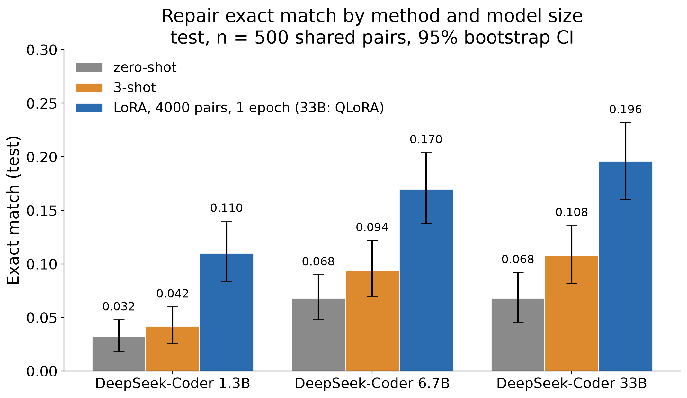
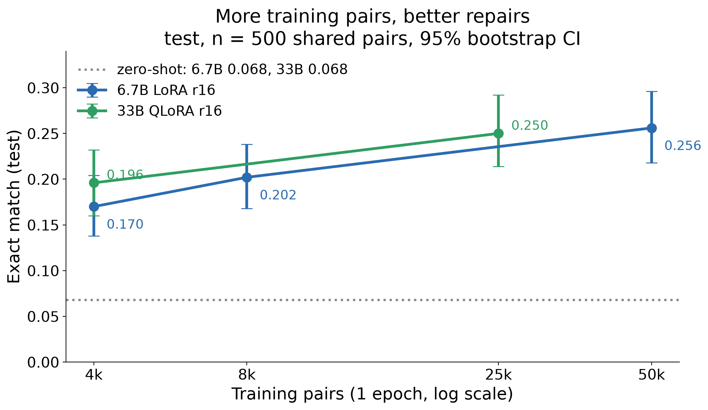

# CodeGuard

LoRA / QLoRA fine-tuning of a code LLM (DeepSeek-Coder-instruct) to **repair single-statement Python bugs**:
given a buggy code fragment, generate the fixed fragment. Detection baselines ("is this snippet buggy?") are
kept as a secondary track. Data: CTSSB-1M, about 1M single-statement bug fixes mined from GitHub
([TSSB-3M](https://github.com/cedricrupb/TSSB3M), cleaned version).

Course project: Introduction to NLP (CSCI1407), KBTU, Fall 2026.
Authors: Zhaxylyk Abdimutalipov, Alrami Dandibay.

## Results

Every number below comes from a run's `metrics.json` and prediction files (`results/results.csv`,
`results/headline.json`). Runs are compared only on the test pairs all of them predicted: 500 pairs (the
small-tier test set) for every run, and the first 2000 full-tier test pairs where a run has them. Brackets:
95% bootstrap intervals. All fine-tuned runs: rank 16, 1 epoch, unless stated.

| Run | Model | Method | Training pairs | Test exact match, 500 shared pairs | Test exact match, 2000 pairs |
|---|---|---|---|---|---|
| `zs_1.3b` | 1.3B | zero-shot | – | 0.032 [0.018, 0.048] | |
| `fs3_1.3b` | 1.3B | 3-shot | – | 0.042 [0.026, 0.060] | |
| `lora_1.3b_r16_4k` | 1.3B | LoRA | 4000 | 0.110 [0.084, 0.140] | |
| `zs_6.7b` | 6.7B | zero-shot | – | 0.068 [0.048, 0.090] | 0.058 [0.048, 0.069] |
| `fs3_6.7b` | 6.7B | 3-shot | – | 0.094 [0.070, 0.122] | 0.086 [0.074, 0.099] |
| `lora_6.7b_r16_4k` | 6.7B | LoRA | 4000 | 0.170 [0.138, 0.204] | |
| `lora_6.7b_r16` | 6.7B | LoRA | 8000 | 0.202 [0.168, 0.238] | |
| **`lora_6.7b_r16_50k`** (selected on val) | 6.7B | LoRA | 50,000 | **0.256 [0.218, 0.296]** | **0.258 [0.239, 0.279]** |
| `zs_33b` | 33B (4-bit) | zero-shot | – | 0.068 [0.046, 0.092] | |
| `fs3_33b` | 33B (4-bit) | 3-shot | – | 0.108 [0.082, 0.136] | |
| `qlora_33b_r16_4k` | 33B | QLoRA | 4000 | 0.196 [0.160, 0.232] | |
| `qlora_33b_r16_25k` | 33B | QLoRA | 25,000 | 0.250 [0.214, 0.292] | |

The final model was chosen on val before any test number was read (`results/selection.json`). On the 150 val
pairs all full-tier candidates share, `lora_6.7b_r16_50k` and `qlora_33b_r16_25k` tie at 0.233 exact match;
the rule then prefers fewer trainable parameters (40M vs 123M). Rank, quantization and seed runs, the
detection track and every other metric are in `results/` and in the figures in `results/figures/`.





**Findings**

1. Fine-tuning beats prompting at every model size: on 2000 test pairs the 6.7B LoRA model fixes 25.8% of
   bugs exactly, against 5.8% zero-shot and 8.6% with three examples (paired difference to zero-shot +0.200
   [+0.182, +0.219]).
2. More training pairs help the most: the 6.7B model goes from 0.170 (4000 pairs) to 0.202 (8000) to 0.256
   (50,000), and the 33B model from 0.196 (4000) to 0.250 (25,000).
3. A bigger model helps less than more data: with the same 4000 pairs, 33B QLoRA beats 6.7B LoRA by +0.026
   [−0.002, +0.056], and the best 33B and best 6.7B runs differ by −0.006 [−0.030, +0.018].
4. LoRA rank (8, 16, 32) and 4-bit quantization move exact match by at most 0.016 on 4000 pairs, about the
   same as changing the random seed (0.158 to 0.172 over seeds 42, 43, 44).
5. With 50,000 pairs the model edits exactly the developer's line in 86% of test pairs but writes the
   developer's exact fix in only 26%. Isolated detection ("is this snippet buggy?") stays at chance for all
   four detectors (accuracy 0.499 to 0.523).

**Limitations**

- **Narrow task.** Single-statement bugs only, shown as fragments of about 7 lines without the rest of the
  file.
- **Strict metric.** Exact match counts an equivalent but differently written fix as wrong. We did not check
  how many of the 60% "right line, wrong fix" outputs (`results/error_examples.md`) are correct
  alternatives.
- **33B differs in more than size.**
  - The 33B model always runs in 4-bit, so for 33B size and quantization are not separated.
  - Its val numbers use 150 pairs instead of 500.
  - It was trained on 25,000 pairs, not 50,000.
- **Few seeds and short training.** One seed per configuration, except three seeds for 6.7B r16 on 4000
  pairs. One epoch for all server runs.
- **Width of the intervals.** Most comparisons use 500 test pairs, so differences under about 0.03 are
  within noise.
- **Data cleaning.** Deduplication is exact-match only; 4.9% of the pool is Python 2 code.

Earlier small-tier numbers (Colab, 2026-11-13) were produced with an older generation rule: the model
wrote an explanation first and was often cut off inside the code block. They are kept only in
`results/superseded.csv` and are not compared with the numbers above.

Facts for the defense (every hyperparameter, data sizes, costs, hardware, versions, with file:line):
[docs/DEFENSE_FACTS.md](docs/DEFENSE_FACTS.md). Design: [docs/AGENT_GUIDE.md](docs/AGENT_GUIDE.md). Team guide
in Russian: [docs/PROJECT_GUIDE_RU.md](docs/PROJECT_GUIDE_RU.md). Server window:
[docs/SERVER_RUNBOOK.md](docs/SERVER_RUNBOOK.md).

## Demo

The demo serves the 1.3B model with the Colab-trained adapter `runs/lora_1.3b_r16_small/adapter` (the 1.3B
run with the best val exact match: 0.126 on 500 val pairs). It fits a 4 GB laptop GPU: about 3.5 GB in use
on an RTX 3050 Laptop GPU.

Start it from the repository root, with the adapter present at that path:

```powershell
# Windows PowerShell
.venv\Scripts\python app\server.py --port 8000
```

```bash
# Git Bash / Linux
.venv/Scripts/python app/server.py --port 8000      # Linux: .venv/bin/python
```

Then open http://127.0.0.1:8000, or send a request:

```bash
curl -s http://127.0.0.1:8000/repair -H "Content-Type: application/json" \
     -d '{"code": "def average(values):\n    total = sum(values)\n    return total / len(value)"}'
```

To choose another model or adapter, use the environment variables `CODEGUARD_MODEL`, `CODEGUARD_REVISION`,
`CODEGUARD_ADAPTER`, `CODEGUARD_QUANTIZED` and `CODEGUARD_DTYPE`. They are documented in `app/server.py`.

Recorded on 2026-11-27 on the RTX 3050 Laptop GPU (seconds = generation time reported by the server):

| Input | Output | Changed lines | Seconds |
|---|---|---|---|
| `return total / len(value)` (undefined name) | `return total / len(values)` | 3 | 4.89 |
| `if age > 18:` (adult at 18) | unchanged | – | 2.78 |
| `return items[len(items)]` (index out of range) | `return items[-1]` | 4 | 2.04 |

## Layout

```
data/raw/                 CTSSB-1M shards (not in git)
data/processed/small/     train/val/test.parquet, 4000/500/500 pairs (not in git)
data/processed/full/      train/val/test.parquet, 50000/2000/5000 pairs; small is a subset (not in git)
notebooks/
  01_data.ipynb           data preparation, both tiers, EDA plots
  02_baseline.ipynb       TF-IDF + logistic regression (detection)
  03-05                   BiLSTM, LLM zero-shot and LoRA detection (legacy track)
  06_results.ipynb        figures, error analysis, cost table from runs/ and results/
src/
  data_utils.py           loading, diff -> code, dedup, project split, nested sampling, length filter
  experiment_utils.py     load_pairs, bootstrap intervals, run metadata
  llm_utils.py            model loading (bf16 / 4-bit / multi-GPU), detection prompt and scoring
  repair_utils.py         repair prompt, label masking, generation, parsing, repair metrics
  train_repair.py         LoRA / QLoRA training for repair, then evaluation on val and test
  eval_repair.py          zero-shot / 3-shot / adapter evaluation
  make_report.py          runs/ -> results/*.csv, selection.json (chosen on val only, shared pairs)
  bilstm.py, llm_baseline.py, train_lora.py   detection track
scripts/
  make_figures.py         results/ -> results/figures/*.png (slide figures)
  compare_shared.py       metrics of several runs on the pair_ids all of them predicted
  download_models.py      pre-fetch weights; print pinned revisions
  preflight.py            environment / GPU / data / model checks and a timing run
  a100_night.py           the unattended single-A100 queue used for the final runs
app/                      FastAPI demo (server.py + index.html)
tests/                    unit and smoke tests on tiny models and synthetic fixtures
results/                  report tables, selection.json, error_examples.md, figures
runs/                     one directory per run: metrics.json, predictions, adapter (not in git)
```

## How to run (small tier, Windows PowerShell)

```powershell
python -m venv .venv
.venv\Scripts\activate
python -m pip install -r requirements.txt
python -m pip install torch==2.14.1 --index-url https://download.pytorch.org/whl/cu126   # CUDA build
python -m pip install -r requirements-neural.txt

# raw data: data/raw/ctssb/ctssb_data_1M/file-0.jsonl.gz ... file-9.jsonl.gz
python -m pytest tests -q
jupyter nbconvert --to notebook --execute --inplace notebooks/01_data.ipynb   # builds both tiers
jupyter nbconvert --to notebook --execute --inplace notebooks/02_baseline.ipynb
python src/bilstm.py --output runs/bilstm_small
```

Repair runs on the small tier with the 1.3B model (one GPU; set `CUDA_VISIBLE_DEVICES` if you have several):

```powershell
$M = "deepseek-ai/deepseek-coder-1.3b-instruct"; $REV = "e063262dac8366fc1f28a4da0ff3c50ea66259ca"
python src/eval_repair.py  --model $M --revision $REV --output runs/zs_1.3b_small --shots 0
python src/train_repair.py --model $M --revision $REV --output runs/lora_1.3b_r16_small --rank 16 `
    --batch-size 2 --accumulation-steps 16
python src/make_report.py --runs runs --results results
```

Add `--limit-pairs 16` for a quick smoke run (write it to a separate output directory). Every script writes
`metrics.json` last and skips the run if it already exists, so re-running a command after a crash continues
where it stopped. Data defaults to `data/processed/small`; pass `--data-dir data/processed/full` for the full
tier.

The final tables and figures were built from the A100 runs and the Colab run:

```powershell
python src/make_report.py --runs out_server/night_20261117/runs runs --results results
python scripts/make_figures.py --runs out_server/night_20261117/runs runs --out results/figures
```

GPU runs on Google Colab (free T4): `python scripts/make_colab_bundle.py` writes
`dist/codeguard_colab_bundle.zip`. Upload it to `MyDrive/CodeGuard/`, open `notebooks/colab_runs.ipynb` in a
T4 runtime and use Run all.

## Data

| Step | Pairs |
|---|---|
| Raw records | 966,985 |
| `in_function` | 714,241 |
| Single hunk | 714,241 |
| Real change (buggy != fixed) | 713,790 |
| After deduplication | 647,850 |
| After removing cross-split duplicates | 647,683 |
| After length filter (<= 2000 chars and <= 60 lines) | 647,571 |
| Small tier (train / val / test) | 4000 / 500 / 500 |
| Full tier (train / val / test) | 50,000 / 2000 / 5000 |

Splits are by project (80/10/10); no project or snippet is shared between splits in the pool or in either
tier, and small is a strict subset of full within every split. Python 2 share: 4.9% of the pool.
Source: `results/summary.json`.

## Evaluation protocol in one paragraph

Every run writes predictions for val and test. `make_report.py` picks the final configuration by val exact
match and writes that choice to `results/selection.json` before it reads any test number. Runs are compared
only on the pair_ids all of them predicted, with the pair count next to every number. Metrics:
- **exact match** after whitespace normalization (headline);
- **localized**: the model edited the line the developer edited;
- **localized_exact**: the model edited exactly the developer's lines and nothing else;
- copy rate, and BLEU next to the copy baseline;
- **fix-direction accuracy**: `log P(fixed | buggy) > log P(buggy | fixed)`, chance 0.5.

Intervals are 95% percentile bootstrap (2000 resamples); differences are paired bootstraps over the shared
pairs.
